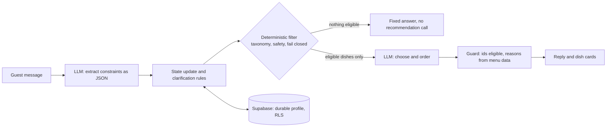

# TastePilotAI

TastePilotAI is an Arabic-first restaurant assistant. A guest describes what they want in natural Gulf Arabic; a language model
interprets the request and recommends dishes from a menu, while **hard constraints (allergies, diet, disliked ingredients, budget,
spice) are enforced by deterministic code, not left to the model**. Signed-in guests get a durable profile that is remembered
across conversations. The project is a technical case study in using an LLM for language and judgement, and ordinary code for
guarantees.

|  |  |
|---|---|
| **Live app** | <https://taste-pilot-ai.streamlit.app/> |
| **Repository** | <https://github.com/NouraAlfantoukh/taste-pilot-ai> |
| **Try it in five minutes** | [docs/TESTING_GUIDE.md](docs/TESTING_GUIDE.md) (guest mode, no account needed) |
| **Engineering write-up** | [docs/DEEP_DIVE.md](docs/DEEP_DIVE.md) |

## Highlights

- **Constraints enforced in code.** Dishes that break a declared allergy, a dislike, the diet, the budget or the spice limit never
  reach the model's candidate list, and the model's picks are validated against the eligible set.
- **Fail-closed allergies.** Unknown or ambiguous allergen words are asked about and block recommendations; allergen data must be
  reviewed (a fingerprinted review record, [docs/MENU_REVIEW.md](docs/MENU_REVIEW.md)) or the dish is excluded for allergic guests.
  The assistant never calls a dish "safe".
- **Explanations built from menu data.** The reason under each dish (for example "غير حار حسب بيانات القائمة") is generated from the
  recorded fields, never from model prose.
- **Memory across conversations.** Allergies, dislikes, vegetarian and spice limits are stored per user in Supabase under Row Level
  Security (anon key, one client per browser session). Budget, category and temperature are per request and never stored.
- **Readable state.** A read-only «ملفي الغذائي» panel shows what is saved, what is not yet saved and what failed to save; the UI never
  claims a save that did not happen. Guests can ask «وش تعرف عني؟».
- **Requests for a specific food.** «أطباق فيها فطر» is answered honestly (no such dish, or a clash with a saved dislike that the guest
  may lift for that one request); allergies are never overridable.
- **Graceful degradation.** Claude is primary; Gemini is used only when Claude is unavailable or fails with a recoverable error; missing
  keys, outages and expired sessions produce clear Arabic messages.

## Quick start

```bash
git clone https://github.com/NouraAlfantoukh/taste-pilot-ai.git
cd taste-pilot-ai
python -m venv .venv
# Windows (PowerShell): .venv\Scripts\Activate.ps1      macOS / Linux: source .venv/bin/activate
pip install -r requirements.txt
cp .env.example .env          # Windows: copy .env.example .env   (then fill in your own values)
streamlit run app.py
```

Python 3.12 or newer. The deployment runs 3.12; the offline test suite was run on 3.12 and 3.14.

## Configuration

Settings are read from environment variables first, then from Streamlit secrets (`config.py`). Never commit real values: `.env` and
`.streamlit/secrets.toml` are git-ignored, and [.env.example](.env.example) lists the names only.

| Variable | Required? | Purpose |
|---|---|---|
| `ANTHROPIC_API_KEY` | one of the two model keys | Claude, the primary model |
| `GEMINI_API_KEY` | one of the two model keys | Gemini, used when Claude is unavailable or fails recoverably (or as the only model) |
| `ANTHROPIC_MODEL` | optional | Claude model name (default `claude-haiku-5-5`) |
| `GEMINI_MODEL` | optional | Gemini model name (default `gemini-3.8-flash`) |
| `ANTHROPIC_EFFORT` | optional | Claude thinking depth (default `low`; `off` omits the parameter) |
| `SUPABASE_URL` and `SUPABASE_KEY` | both, to enable accounts and memory | The project URL and the **anon / publishable** key. The app refuses a `service_role` or secret key. If either is empty the app runs as a guest-only assistant that saves nothing. |

With no model key the app starts and shows an Arabic notice with the chat disabled. For persistence, apply
`supabase/migrations/*.sql` to your project ([supabase/README.md](supabase/README.md)).

### Streamlit Community Cloud

Repository `NouraAlfantoukh/taste-pilot-ai`, branch `main`, main file `app.py`; paste the variables above as TOML in *Advanced settings -> Secrets*.
In Supabase set *Authentication -> URL Configuration -> Site URL* to the app URL. Full steps and troubleshooting:
[docs/DEPLOYMENT.md](docs/DEPLOYMENT.md). The deployed app runs on Python 3.12 with the pinned `requirements.txt`.

## Architecture



1. **Extract** (`agent/extraction.py`): the model turns the message into strict, validated JSON; malformed output never becomes empty constraints.
2. **Update state** (`agent/orchestrator.py`, `agent/state.py`): constraints, pending clarifications and the allergy question are managed in plain Python.
3. **Filter** (`services/recommendation_service.py`, `services/safety_service.py`): the taxonomy (`data/taxonomy.json`) maps words to ingredient and allergen families; anything not established as safe is excluded.
4. **Recommend**: the model sees only the eligible dishes and picks among them.
5. **Guard** (`agent/guard.py`, `agent/explain.py`): picks must be eligible dish ids; malformed output falls back to the top eligible dishes without model prose; reasons come from menu data.
6. **Persist** (`agent/persistence.py`, `services/memory_service.py`): only confirmed durable facts are saved.

## Testing

```bash
pip install -r requirements-dev.txt
python -m pytest                        # offline suite
python -m pytest -m integration -s      # opt-in: real Claude and real Supabase test users (own keys needed)
```

Latest verified offline result: **1030 passed, 59 deselected (the deselected tests are the opt-in integration tests)** (Python 3.14.2 locally). The same suite on Python 3.12.x, the deployment version, with the pinned dependencies: **1030 passed, 59 deselected on Python 3.12.10**.
The offline suite uses a scripted model and a fake Supabase that emulates Row Level Security, so it needs no network or keys. The
real-service tests (RLS with two authenticated users, persistence across sessions, key conversations on real Claude) are opt-in and
were run during development; results and what remains unverified are in [docs/QA_REPORT.md](docs/QA_REPORT.md).

## Deep Dive summary

**Question:** is a prompt enough to enforce hard constraints, or does deterministic enforcement earn its complexity? Full report with
method, denominators, limitations and a claims-and-evidence table: [docs/DEEP_DIVE.md](docs/DEEP_DIVE.md).

- 53 author-written scenarios, a 15-dish production menu and a 60-dish synthetic menu, real runs on `claude-haiku-5-5` (about 550 calls, raw outputs stored in `evaluation/results/`).
- **Measured:** the prompt-only baseline and the pipeline both showed **zero constraint violations** in the scored runs (263 and 265 runs), so the study does **not** show a lower real-model violation rate for the pipeline.
- **Measured:** the pipeline's user message was about **42% shorter in characters** on like-for-like scenarios (characters, not tokens; no cost was measured) and skipped the recommendation call in 10 of 53 scenarios; the baseline lost 10 of 104 answers to truncation on the 60-dish menu (cause inferred, not proven); 27-33% of the baseline's own explanations contained absence claims the product forbids.
- **Simulated (not a real-model result):** when the model is replaced by one that ignores every constraint, the baseline violates constraints in 42 of 53 scenarios and the pipeline in 0.

## Known limitations

- The menu is fictional (15 dishes). `verified` allergen status comes from a documented review done by an AI assistant on test data, **not a kitchen audit**; only 14 allergen categories are tracked; cross-contact and recipe changes are not modelled.
- A dislike for a food outside the known ingredient vocabulary is acknowledged but cannot be saved (the stored profile holds known ids only). Favourite ingredients and a usual budget are not stored.
- Model interpretation of unusual phrasing is probabilistic; safety does not depend on it, clarification quality does.
- Evaluation scope: one model, a small author-written scenario set, structured constraints, single turns; the oracle and the pipeline share the taxonomy (see the Deep Dive).
- Signing out ends that account's sessions on every device; give each reviewer their own account.
- The `.devcontainer` (generated by the hosting platform's template) pins a Python 3.11 image, which was not tested.

## Project structure

```
app.py                  Streamlit entry point: auth gate, chat, profile panel
config.py               settings from environment / Streamlit secrets
agent/                  extraction, orchestration and state, persistence bridge, guard, explanations, prompts
services/               LLM providers, taxonomy, constraints, safety, recommendation, menu and menu review, memory, auth
ui/                     components and styles (RTL, Arabic)
db/                     Supabase client factory (one client per session, anon key only)
data/                   menu.json, taxonomy.json, menu_review.json
supabase/               migration (table and RLS policies) and notes
evaluation/             Deep Dive harness: scenarios, oracle, both systems, scoring, fault injection, stored raw results
tests/                  offline suite and opt-in integration tests
docs/                   DEEP_DIVE, TESTING_GUIDE, QA_REPORT, MENU_REVIEW, DEPLOYMENT
```
