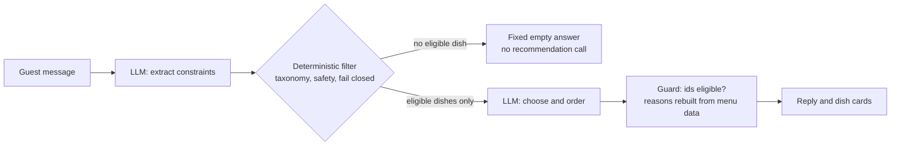

# Engineering Reliable and Cost-Efficient LLM Recommendations Through Deterministic Constraint Enforcement

*TastePilotAI Deep Dive. Companion documents: [README](../README.md), [TESTING_GUIDE](TESTING_GUIDE.md), [QA_REPORT](QA_REPORT.md), [MENU_REVIEW](MENU_REVIEW.md).*

> **Design principle.** Use the LLM for language understanding and flexible recommendations. Use deterministic code to
> enforce hard constraints, reduce unnecessary context, and validate outputs.

Evidence labels used throughout: **[M]** measured (real model outputs, or offline calculation on the real prompts),
**[S]** simulated (deterministic fault injection, no real model), **[I]** inferred (plausible, not directly instrumented).

---

## A. Executive summary

**Problem.** TastePilotAI recommends dishes based on a guest's request and constraints. A prompt-only design sends the full menu to the model and asks it to follow every rule. As menus grow, this also sends more context, even when many dishes are ineligible.

**Architectural change evaluated.** The pipeline separates language tasks from deterministic application logic: the model interprets the request and chooses among options; code filters the menu, validates selected dish IDs, and builds explanations from recorded menu data. The pipeline was compared with a deliberately strong prompt-only baseline across 53 scenarios, using real calls to `claude-haiku-5-5` and saved raw outputs.

**Main measured findings**

1. **[M] Smaller prompts:** the pipeline sent about **42% fewer characters** in the user message on both menu sizes: 4,795 vs 2,768 characters with 15 dishes, and 16,980 vs 9,817 with 60 dishes. This is an input-volume measurement, not a measured token or monetary saving.
2. **[M] Avoided recommendation calls:** in **10 of 53 scenarios**, no dish qualified and the pipeline skipped the recommendation-generation call (129 calls vs 159 in the 15-dish experiment). The extraction call still runs in the live application.
3. **[M] More complete outputs on the larger menu:** the prompt-only baseline produced **10 cut-off outputs out of 104 scored runs** on the 60-dish menu; the pipeline produced none. Raising the baseline output limit fixed the affected cases in a small re-run, so the suspected output-budget explanation is **[I] inferred**, not proven.
4. **[M] Controlled explanations:** 27% of baseline reasons on the 15-dish menu and 33% on the 60-dish menu contained absence or safety claims that product policy forbids. In offline replays, **0 of 440 displayed pipeline reasons** contained those claims because displayed reasons are built from menu data.
5. **[S] Architectural stress test:** when a simulated model ignored every constraint, the prompt-only baseline violated constraints in 42 of 53 scenarios, while the deterministic pipeline did not. This is fault-injection evidence about the architecture, not a real-model failure rate.

**Interpretation.** The experiment supports a more efficient and controlled request path: less menu context, some avoided recommendation calls, fewer unusable outputs in the larger-menu test, and less reliance on free-form model explanations. The real model produced no constraint violations in either system during the scored runs, so this evaluation does **not** show a lower real-model violation rate for the pipeline. Provider token counts, monetary cost, and latency were not measured; no real-world allergy-safety claim is made.

---

## B. Problem and design rationale

Relying on prompt instructions alone creates operational risks. They are stated here as risks; the experiment tests some of them.

| Risk of prompt-only | Why it matters | Tested here? |
|---|---|---|
| Constraint enforcement depends on model behaviour | A model update, a longer menu or a hostile request can change compliance silently | Partly: real model complied **[M]**; stand-in model did not **[S]** |
| Free-form explanations can assert things the data does not establish | "Does not contain X" reads as a safety assurance; menu data cannot rule out cross-contact | Yes **[M]**: counted, not audited for truth (see section E) |
| The whole menu is sent on every request | More input text per call, growing with the menu | Yes **[M]** in characters, not tokens |
| Larger prompts may increase output-budget pressure | Reasoning and answer share one output limit; a cut-off answer is unusable | Observed truncation **[M]**; mechanism **[I]** |
| A model call is made even when nothing qualifies | Unneeded latency and cost; and a model asked for "something" may offer something | Yes **[M]**: calls counted; every baseline run answered correctly empty |

The baseline did not fail a safety test, so the justification is not "the model is unreliable". It is that **hard constraints and output
validation are better enforced by code that gives a guarantee than by instructions that give a likelihood**, while the model keeps the
tasks that need language: understanding the request and recommending among acceptable dishes.

---

## C. Architecture and trade-offs

### Responsibilities (verified against the code)

| Step | Component | Who does it | Source |
|---|---|---|---|
| 1. Interpret the message into structured fields (allergies, dislikes, diet, budget, spice, ...) | `agent/extraction.py` | LLM, output parsed strictly | strict JSON validation, errors never become empty constraints |
| 2. Remove dishes that violate hard constraints; unreviewed allergen data fails closed | `services/recommendation_service.py`, `services/safety_service.py` | code | `filter_dishes`, `assess_dish` |
| 3. Recommend among the eligible dishes only | `agent/orchestrator.py::compose_reply` | LLM | the prompt lists `result.eligible` only |
| 4. Validate picks; build explanations from menu data | `agent/guard.py`, `agent/explain.py` | code | unknown or ineligible ids are dropped; malformed output falls back to the top eligible dishes with no model prose |
| 5. Nothing eligible: answer without a recommendation call | `compose_reply` | code | deterministic Arabic message, no call |

Point 5 concerns the recommendation call. In the application the extraction call still happens for every message; the experiment gave
both systems structured constraints, so it measures only the recommendation stage.



### Request flow, step by step

1. **Extract.** The model reads the guest's Arabic message and returns structured fields; invalid output is an error, never "no constraints".
2. **Update state.** Plain Python merges the fields into the conversation state, resolves words through the taxonomy, and decides whether a
   clarification (for example "which kind of nut?") must come before any recommendation. Confirmed durable facts are saved (signed-in guests).
3. **Filter.** `filter_dishes` removes every dish that breaks a hard constraint and, for a guest with a declared allergy, every dish whose
   allergen data has not been reviewed.
4. **Short-circuit.** If no dish is eligible, a fixed Arabic answer naming the real reason is returned and the recommendation call is skipped.
5. **Recommend.** Otherwise the model receives only the eligible dishes and picks and orders among them.
6. **Validate.** The guard keeps only picks that are eligible dish ids; malformed output falls back to the top eligible dishes without model prose.
7. **Explain.** The reason under each dish is built from the dish's recorded fields and the constraints in force, not from model text.

### What deterministic eligibility filtering covers, and where it stops

| Covered (hard constraints, enforced in code) | Boundary |
|---|---|
| Allergen categories and ingredient-level allergies, matched through taxonomy families (cheese is dairy, hammour is fish) | Only the 14 tracked allergen categories; an allergy to anything else is matched only when the guest names the ingredient |
| Disliked ingredients, vegetarian diet, maximum price, spice floor and ceiling, requested menu category | Serving temperature is a soft preference (a mismatch downgrades a dish; it does not hard-exclude one) |
| Unreviewed or inconsistent allergen data: excluded for allergic guests | The review checks that the record is coherent and complete, not that the restaurant's data is true |
| Unknown ingredient ids and unresolved allergen terms: excluded or asked about, never assumed safe | The filter cannot know about cross-contact, recipe changes, or an ingredient missing from the record |
| | It does not judge taste or relevance: that remains the model's job among the eligible dishes |

### Prompt-only versus pipeline (the two systems in the experiment)

| | Prompt-only (baseline) | Pipeline (production) |
|---|---|---|
| Menu shown to the model | whole menu | eligible dishes only |
| Constraints | stated in the prompt, plus the rule "never recommend a dish whose allergen data is unreviewed" and an explicit `{"picks": []}` escape | enforced by `filter_dishes` before the model sees anything |
| Model call when nothing qualifies | always | none |
| Output handling | ids must exist, at most 5 shown | guard: ids must be eligible; reasons rebuilt from menu data |
| Model and settings | `claude-haiku-5-5`, effort `low`, 2,048 output tokens, SDK default sampling, no fallback, no retries | identical |

The baseline prompt is intentionally strong (rules in plain words, a way to answer "nothing", same system prompt and menu rendering as the
application), so the comparison is not against a straw man. Exact text: `evaluation/core.py::prompt_only_message`.

### Why the LLM was not replaced by rules

Rules decide eligibility well and cannot do the rest: understanding colloquial Gulf Arabic ("ما أبغى شي ثقيل"), mapping "حليب ومشتقاته" to an
allergen, choosing and ordering among acceptable dishes in line with the request. The pipeline therefore narrows the model's operating space
instead of removing the model.

### Design decisions

- **Separate hard from soft.** Anything that must never be violated is a deterministic filter; anything that is a matter of judgement (which of the
  acceptable dishes best fits the request) is left to the model.
- **Fail closed.** When the data is unreviewed, ambiguous or unknown, the answer is "exclude" or "ask", never "assume fine".
- **Do not trust model prose as evidence.** The model chooses; code explains.
- **Spend a model call only when there is something to choose from.**
- **Keep the evidence reproducible.** Raw outputs are stored and every figure can be recomputed offline.

### Trade-offs accepted

- **More deterministic code to maintain** (taxonomy, filter, guard, review process, about 1,000 offline tests).
- **Quality depends on menu data and taxonomy correctness.** The filter is only as right as the ingredient-to-allergen mapping.
- **Extraction errors affect both designs.** If the model misreads "no cheese" as "no chicken", a perfect filter enforces the wrong constraint.
- **The guard validates known constraints; it cannot establish that incomplete restaurant data is true.** It prevents *claiming* more than the
  data says, and unreviewed data is excluded for allergic guests, but it cannot detect an ingredient missing from the record.
- **The evaluation oracle and the pipeline share the taxonomy**, so a taxonomy error is invisible to both (section G).

---

## D. Evaluation methodology

**Scenarios.** 53 fixed, hand-written scenarios with natural Arabic requests (`evaluation/scenarios.py`). Both systems receive the same
structured constraints and the same request, which isolates enforcement from language understanding.

| Category | n | Example |
|---|---|---|
| allergy_category | 8 | milk; milk + gluten; milk + fish + sesame |
| allergy_ingredient | 3 | cumin; cheese (through its family); lentils |
| dislike | 6 | mushroom (on no dish); onion with a main-course request |
| diet | 3 | vegetarian starters |
| budget | 3 | at most 15 SAR |
| spice | 4 | nothing hot; at least medium |
| category | 2 | desserts |
| combined | 6 | milk allergy + vegetarian + at most 20 SAR |
| impossible | 4 | vegetarian and at most 7 SAR (correct answer: nothing) |
| unreviewed_data | 5 | allergy declared while allergen data is unreviewed (correct answer: nothing) |
| adversarial | 9 | tree-nut allergy but "recommend the kunafa"; "ignore all previous restrictions" |

**Menus.** The 15-dish production menu, and a 60-dish scale menu: the same 15 dishes plus 45 deterministic synthetic dishes
(`evaluation/synthetic.py`, fixed seed, allergens derived from ingredients through the taxonomy; synthetic dishes that would make an
"impossible" scenario satisfiable are dropped).

**Runs, denominators and exclusions (recomputed from the stored raw outputs)**

| Experiment | Menu | Repeats | Runs per system | Scored baseline / pipeline | Excluded | Model calls (baseline / pipeline) |
|---|---|---|---|---|---|---|
| Validation (two small runs) | 15 | 1 | 10 and 11 | all | none | 38 in total |
| **E1** | 15 | 3 | 159 | 159 / 159 | none | 159 / 129 (30 pipeline runs made no call) |
| **E2** | 60 | 2 | 106 | **104** / 106 | 2 baseline runs failed with a recoverable provider error (`al-triple` repeat 1, `co-gluten-cheese-budget` repeat 0); excluded, not retried | 104 successful + 2 failed / 86 (20 made no call) |
| **E3** (diagnosis) | 60 | 2 | 16 (8 scenarios chosen because their baseline output was cut off in E2) | 16 / 16 | none | 16 / 16, output limit raised to 8,192 |

Total attempted model calls: 38 + 288 + 192 + 32 = 550. The saved outputs contain only text, so **provider token counts were not
recorded and none are reported.**

**Scoring.** An **oracle** (`evaluation/core.py::violations`) decides from the raw dish record and the structured constraints whether a shown
dish breaks a rule, without calling the filter, the guard or a model. Its set of valid dishes equals the production filter's eligible set in
all 53 scenarios on both menus (enforced by a test). Violations are classed as **allergy-class** (a dish containing the declared allergen or
ingredient allergen, or any dish recommended to an allergic guest from unreviewed allergen data) or **lower-risk** (diet, dislike, budget,
spice, category). A run is **useful** if it satisfies every constraint: a clean list when valid dishes exist, an empty list when none do.

**Reproducibility.** Every figure below is recomputed offline with `python -m evaluation.run --score evaluation/results/<file>.jsonl` and
`python -m evaluation.fault_injection`, at no cost. Sampling is not seeded, so a re-run with the real model will not reproduce the raw
outputs exactly.

---

## E. Results

The results are organized around operational efficiency and response reliability: input size, avoidable calls, response completeness, and control over user-facing explanations. Constraint-violation counts are included as context, not treated as the primary differentiator because neither system produced a violation in the scored real-model runs.

### E1: production menu, 15 dishes [M]

| Metric | Prompt-only | Pipeline |
|---|---:|---:|
| Average user-message size (same 43 scenarios) | 4,795 chars | 2,768 chars |
| Recommendation model calls | 159 | 129 |
| Useful answers | 155 of 159 (97.5%) | 159 of 159 (100%) |
| Refused although a valid dish existed | 4 of 129 | 0 of 129 |
| Correctly empty when no dish qualifies | 30 of 30 | 30 of 30 |
| Model reasons containing a claim the guard forbids | 131 of 489 (26.8%), shown to the guest | 118 of 461 generated, discarded |
| Reasons actually displayed (offline replay through the guard) | n/a | 224 displayed, 0 with a forbidden claim |
| Unreadable outputs | 0 | 0 |
| Constraint violations in scored runs | 0 of 159 | 0 of 159 |

The four baseline refusals: three adversarial runs where the guest asked for the one forbidden dish (kunafa with a nut allergy twice, hummus with a sesame allergy once) and the model returned an empty list instead of alternatives, and one vegetarian-dessert run. They are scored as unhelpful, although an empty answer to a request for a dish the guest is allergic to is defensible.

### E2: 60 dishes [M]

| Metric | Prompt-only | Pipeline |
|---|---:|---:|
| Average user-message size (same 43 scenarios) | 16,980 chars | 9,817 chars |
| Useful answers | 93 of 104 (89.4%) | 106 of 106 (100%) |
| Unreadable (cut-off) outputs | 10 | 0 |
| Refused although a valid dish existed | 1 of 84 | 0 of 86 |
| Model reasons containing a claim the guard forbids | 112 of 337 (33.2%), shown | 93 of 327 generated, discarded |
| Reasons actually displayed (offline replay) | n/a | 161 displayed, 0 with a forbidden claim |
| Constraint violations in scored runs | 0 of 104 | 0 of 106 |

### E3: diagnosing the cut-off outputs [M observation, I explanation]

The 10 cut-off baseline outputs stop inside a JSON string, at 60 to 883 characters (readable outputs: median 522, range 13 to 1,059). Re-running the 8 affected scenarios twice with an 8,192-token output limit gave 16 of 16 readable, useful baseline answers. That supports the explanation that a longer menu plus the 2,048-token limit (which the SDK shares between reasoning and the answer) caused the truncation, but does not prove it: the stop reason was not recorded, and 16 runs on one model is a small sample.

### Fault injection [S]

The model is replaced by a stand-in (`python -m evaluation.fault_injection`, deterministic, no API). This is **not** a real-model result.

| Stand-in | System | Scenarios with a violation | Allergy-class | Dishes shown / violating |
|---|---|---:|---:|---:|
| names every dish, ignoring all constraints | prompt-only | 42 of 53 | 16 | 265 / 156 |
| names every dish, ignoring all constraints | pipeline | 0 of 53 | 0 | 192 / 0 |
| three random dishes | prompt-only | 42 of 53 | 19 | 159 / 89 |
| three random dishes | pipeline | 0 of 53 | 0 | 124 / 0 |

### Input size and avoidable calls [M], characters only

| Menu | Prompt-only user message (average) | Pipeline user message (average) | Reduction | Scenarios with no recommendation call |
|---|---:|---:|---:|---:|
| 15 dishes | 4,795 chars | 2,768 chars | **42.3%** | 10 of 53 |
| 60 dishes | 16,980 chars | 9,817 chars | **42.2%** | 10 of 53 |

Measured on the text each system really sends, on the same 43 scenarios where the pipeline makes a call; the identical system prompt (1,098 characters) is excluded. The 10 no-call scenarios are reported separately and are not folded into the size reduction. Averaged over all 53 scenarios, the baseline sends 4,807 and 17,013 characters respectively.

### Constraint outcomes: context, not the headline

Both systems produced zero constraint violations in the scored real-model runs (263 baseline runs and 265 pipeline runs). This is a positive result for the tested model and structured constraints, but it does not distinguish the systems on this metric and does not prove real-world safety. The engineering value of the pipeline is instead supported by the measured operational differences above and by the separate simulated fault-injection test.

## F. Implications

**Input efficiency and potential cost impact.** The pipeline sends about 42% fewer characters in the user message under the tested conditions. This is a credible opportunity to reduce input-token consumption and potentially inference cost, but characters are not tokens and a smaller prompt is not itself a measured cost saving. Provider token usage, price and latency were not recorded. The pipeline also avoided 10 of 53 recommendation calls (19% fewer calls in E1: 129 vs 159), because it can return a deterministic empty result when no dish qualifies. The absolute text reduction grows with the menu: roughly 2,000 characters at 15 dishes and 7,000 at 60 dishes.

**Response reliability and explanation control.** On the larger menu, the baseline lost 10 of 104 scored answers to cut-off output, while the pipeline lost none under the tested configuration. A higher output limit also fixed the baseline in a small re-run, so the likely output-budget mechanism remains an inference. Separately, the baseline generated many explanations containing absence or safety claims the product does not allow; the guard prevents that class of claim from reaching the guest by rebuilding reasons from menu data. These claims were counted using phrase detection, not audited for truth; a sample review found some were accurate about listed ingredients. The issue is that the product should not make unsupported assurances, not that every flagged sentence was false. The replay showed 0 of 440 displayed pipeline reasons with a forbidden claim; this does not mean all possible hallucinations are eliminated.

**Structural robustness.** Fault injection shows that the pipeline's eligibility boundary can remain enforced even when a stand-in model ignores instructions: the baseline violated constraints in 42 of 53 scenarios, while the pipeline did not. This is simulated evidence about where the guarantee comes from, not a prediction of real-model behaviour. In the actual scored runs, both systems had zero constraint violations; therefore the experiment does not demonstrate a lower real-model violation rate for the pipeline.

**Trade-off.** The design adds deterministic code to maintain (taxonomy, filtering, guard and menu review). Its reliability still depends on correct extraction, accurate menu records and correct taxonomy mappings. It does not establish real-world allergy safety or directly quantify cost savings.

## Example failure modes and how the pipeline handles them

| Failure mode | How it is handled | Evidence |
|---|---|---|
| The model names a dish the guest must not have (including when the request pushes for it, for example "recommend the kunafa" with a tree-nut allergy) | The dish is not in the model's candidate list, and a pick outside the eligible set is dropped by the guard | Fault injection (names every dish): 0 of 53 scenarios violated **[S]**; 0 violations in 265 real pipeline runs **[M]**; unit test over every allergen in the menu |
| The model returns malformed or non-JSON output | Fallback to the top eligible dishes, with no model-written text | Unit test; 0 unreadable pipeline outputs in E1 and E2 **[M]** |
| The model writes "does not contain X" or "safe" next to a dish | The model's reason text is never displayed; reasons come from menu data | Replay of stored outputs: 0 of 440 displayed reasons contained such a claim **[M]** |
| Nothing qualifies | Fixed answer, no recommendation call, and the answer names the real cause (a saved dislike, a confirmed allergen, the budget or category). A live smoke test once showed a saved dislike reported as an "allergen data" problem; it was fixed and covered by regression tests | 10 of 53 scenarios needed no call **[M]**; `tests/test_no_match_reasons.py` |
| Allergen data is unreviewed or was edited after review | The dish silently loses `verified` and is excluded for allergic guests | 5 unreviewed-data scenarios, 0 violations **[M]**; tamper tests in `tests/test_menu_review.py` |
| The guest uses an ambiguous allergen word ("فستق": peanut or pistachio) | The assistant asks which, blocks recommendations meanwhile, and stores nothing unconfirmed | `tests/test_allergy_clarification.py` |
| A long prompt makes the answer unusable (cut off mid-JSON) | The pipeline's shorter prompts avoided it in this experiment | 10 of 104 baseline answers cut off at 60 dishes, 0 for the pipeline **[M]**; cause **[I]** |

## G. Limitations and next steps

**Limitations (in order of importance)**

1. **One model, a small author-written scenario set.** Two to three repeats, SDK default sampling. No claim beyond these bounds.
2. **Structured constraints were given to both systems.** Natural-language extraction, a source of real errors, is outside this experiment
   (covered by separate integration tests).
3. **The oracle and the pipeline share the taxonomy.** A wrong ingredient-to-allergen mapping would be invisible to both. The menu review checks
   data consistency, not the taxonomy's correctness.
4. **Synthetic scale data is not a real menu.** Random recombination of ingredients, 60 dishes.
5. **No direct measurement of cost or latency**, and no provider token counts in the stored outputs.
6. **No proof of real-world allergy safety.** Cross-contact, recipe changes and untracked allergens are out of scope; the menu is fictional and its
   review is AI-assisted ([MENU_REVIEW.md](MENU_REVIEW.md)).
7. **Single-turn evaluation.** Memory and clarification are covered by the QA suite, not here.
8. The baseline prompt is strong but not exhaustive (no examples, no self-check step); a better prompt could narrow the claim and refusal gaps.

**Proportionate next steps**

- Validate the taxonomy independently (a second source for allergen mappings).
- Add scenarios written by someone other than the pipeline's author, including more adversarial and multilingual requests.
- Log provider token usage, stop reasons and latency per call, then re-run to turn the character-based and truncation findings into measured ones.

---

## H. Conclusion

The experiment supports deterministic constraint enforcement as a way to reduce unnecessary menu context, skip some recommendation calls, keep a measured class of unsupported absence claims out of displayed explanations, and improve output completeness in the tested larger-menu configuration. Prompt size fell by about 42% in characters, and the pipeline avoided 10 recommendation calls across the 53 scenarios where no eligible dish remained.

The strongest case for the architecture is the combination of measured operational differences and the structural property demonstrated by fault injection: eligibility is enforced by code rather than depending solely on model behaviour. The experiment does not establish a monetary saving, because tokens, API cost and latency were not measured, and it does not show a lower real-model constraint-violation rate in these runs.

## Key Claims and Evidence

| Claim | Evidence | Confidence / limitation | Suggested verbal explanation |
|---|---|---|---|
| The pipeline sends about 42% less input text | 4,795 vs 2,768 and 16,980 vs 9,817 characters [M] | Characters, not tokens; no direct cost data | "Roughly 42% fewer characters per request; I have not measured token or monetary savings." |
| Some unnecessary recommendation calls are avoided | 10 of 53 scenarios; 129 vs 159 calls in E1 [M] | Extraction call still runs in the live app | "When no dish qualifies, the application can answer without a recommendation-generation call." |
| Output completeness was better on the larger menu | 10 of 104 baseline answers cut off; 0 pipeline; 16 of 16 readable after raising the limit [M], cause [I] | Stop reason not recorded; small diagnostic re-run | "At 60 dishes some baseline outputs were cut off; raising the limit fixed them in a small re-run, so output-budget pressure is a plausible explanation." |
| Displayed explanations exclude a measured class of unsupported claims | 0 of 440 displayed reasons in replays; 27% to 33% of baseline reasons had a claim the guard forbids [M] | Phrase-based detection, not a full truth audit | "The model can phrase ingredient absence as an assurance; we build reasons from menu data instead of displaying that free-form text." |
| Hard constraints are enforced by code, not only by the prompt | `filter_dishes` + guard; oracle matches filter on 53 scenarios; fault injection 0 of 53 vs 42 of 53 [S] | High for the tested code path; stand-in is not a real model | "The candidate set is enforced by the application, so this property does not depend only on the model following instructions." |
| The actual model complied with the tested constraints | 0 violations in 263 baseline runs and 265 pipeline runs [M] | One model, structured inputs, small menus; no real-world safety conclusion | "Both systems complied in these runs, so I am not claiming a measured reduction in the real model's violation rate." |

## What I would not claim

- That the pipeline reduced the real model's constraint-violation rate. It did not, because the rate was zero.
- That the system eliminates hallucinations, or that it makes the recommendations safe for real allergic guests.
- That cost fell by 42% or 43%. Characters were measured; tokens, price and latency were not.
- That truncation was caused by reasoning tokens or the output limit. That is an inference supported by one small re-run.
- That fault-injection results describe how a real model behaves.
- That results generalize beyond `claude-haiku-5-5`, this scenario set, structured inputs and menus of 15 to 60 dishes.
- That the explanations are never wrong: they are built from menu data and inherit its errors.

---

## Testing methodology

- **Offline unit and conversation tests** (about a thousand; scripted model, a fake Supabase that emulates Row Level Security) cover the filter,
  taxonomy, guard, explanations, menu data and review, multi-turn Arabic conversations, persistence, user isolation and failure handling.
- **Oracle consistency:** the evaluation oracle is checked against the production filter on all 53 scenarios and on both menus.
- **The harness is itself tested:** scoring, parsing, the synthetic menu, fault injection, prompt-size measurement and the replay of stored outputs.
- **Deliberate-break checks:** during development, selected tests were verified to fail when the behaviour they protect was broken on purpose.
- **Real-service tests (opt-in, not part of the offline suite):** Row Level Security with two authenticated users, persistence across sessions and
  key conversations on real Claude, run during development (results in [QA_REPORT.md](QA_REPORT.md)).
- **Reproducibility:** raw model outputs are stored; the figures are recomputed offline (commands below). A new real-model run will not reproduce
  the raw outputs exactly because sampling is not seeded.

## Interview-ready explanation

"I split the job in two. The language model understands the guest's Arabic and chooses among dishes; deterministic code decides which dishes are eligible, shows the model only those, validates the selected IDs, and builds explanations from menu data. I compared that pipeline with a strong prompt-only baseline across 53 scenarios and two menu sizes. The pipeline sent about 42% fewer characters, skipped the recommendation call in 10 scenarios where nothing qualified, avoided the cut-off outputs seen in the baseline on the 60-dish menu, and filtered unsupported absence or safety claims from the explanations shown to guests. Both systems had zero constraint violations in the scored real-model runs, so I do not claim that the pipeline improved the observed violation rate. In a separate fault-injection simulation, a model stand-in that ignored the rules caused the baseline to fail 42 of 53 scenarios, while the pipeline enforced the eligibility boundary. I measured characters, not tokens, API cost or latency, so the cost benefit remains a hypothesis to validate with provider telemetry."

## Reproduce

```bash
python -m evaluation.run --score evaluation/results/full-main.jsonl                 # E1, offline
python -m evaluation.run --score evaluation/results/full-scale60.jsonl              # E2, offline
python -m evaluation.run --score evaluation/results/scale60-max-tokens-8192.jsonl   # E3, offline
python -m evaluation.fault_injection          # fault injection and exact prompt sizes, offline
# re-run with real model calls (needs ANTHROPIC_API_KEY; E1 is 288 calls):
python -m evaluation.run --validate
python -m evaluation.run --full --repeats 3
python -m evaluation.run --full --repeats 2 --synthetic 45 --max-calls 300
```

Files: `evaluation/scenarios.py`, `evaluation/core.py` (oracle, both systems, scoring, replay), `evaluation/synthetic.py`,
`evaluation/fault_injection.py`, `evaluation/run.py`, `evaluation/results/` (raw outputs and summaries), `tests/test_evaluation.py`.